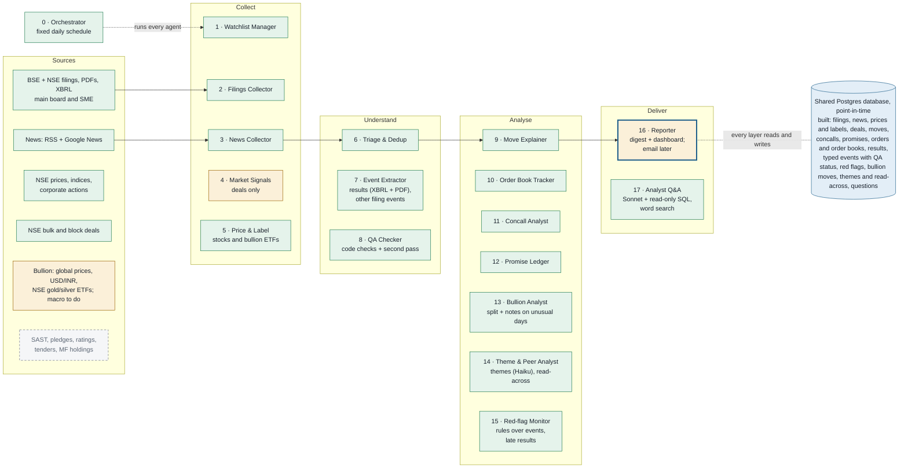

# Agent design

Version 1.17 · Oct 27, 2026 (first written Oct 21, 2026) · @Ramki · companion to the [system design](design.md); changes are listed in [README.md](README.md)

## Agent team at a glance

A code orchestrator runs 17 single-purpose agents in four layers. Agents never call each other directly: each reads its inputs from the shared database and writes its results back, so any agent can be rebuilt or re-run on its own.

```text
Orchestrator (0)
├─ Collect:     1 Watchlist Manager · 2 Filings Collector · 3 News Collector
│               4 Market Signals Collector · 5 Price & Label
├─ Understand:  6 Triage & Dedup · 7 Event Extractor · 8 QA Checker
├─ Analyse:     9 Move Explainer · 10 Order Book Tracker · 11 Concall Analyst
│               12 Promise Ledger · 13 Bullion Analyst · 14 Theme & Peer Analyst
│               15 Red-flag Monitor
└─ Deliver:     16 Reporter · 17 Analyst Q&A
```

### Build status (Oct 27, 2026)

The map below shows what is built and what is pending. Data flows left to right, and every layer reads from and writes to the shared database. Green is built, amber partly built, dashed grey not started; a thick blue border marks the recommended next step.



| Status | Agents |
| --- | --- |
| Built | 0 Orchestrator, 1, 2, 3, 5, 6, 7, 8, 9, 10, 11, 12, 13, 14, 15, 17 |
| Partly built | 4 Market Signals, 16 Reporter |
| Not started | none |
| Recommended next | Email delivery of the digest and high-severity flags (16); Telegram is set aside for now |

| # | Agent | Status | Build step |
| --- | --- | --- | --- |
| 0 | Orchestrator | Built: fixed schedule, run log; no LLM | 6 |
| 1 | Watchlist Manager | Built: no LLM needed (fuzzy matching in code); NSE SME list; peers; dashboard page | 2, 7, 11 |
| 2 | Filings Collector | Built: BSE + NSE | 3 |
| 3 | News Collector | Built: RSS + Google News, history since Oct 2023 | 4, 8 |
| 4 | Market Signals Collector | Partly: NSE bulk and block deals only | 11 |
| 5 | Price & Label | Built: stocks, and bullion through the NSE gold and silver ETFs in the same bhavcopy | 5, 19 |
| 6 | Triage & Dedup | Built (Haiku 5.5) | 9 |
| 7 | Event Extractor | Built: results figures for every stock, from XBRL where filed, else the PDF (Haiku 5.5); typed events from the other filings (Haiku 5.5) | 16, 17 |
| 8 | QA Checker | Built: code checks on every event, a second pass (Sonnet 5.5) on flagged and important ones, a review queue | 17 |
| 9 | Move Explainer | Built (Sonnet 5.5) | 10, 11 |
| 10 | Order Book Tracker | Built: orders from filings (Haiku 5.5), quarterly order books (Sonnet 5.5), metrics and peer ranks; coverage per stock; revenue gaps filled from results | 14, 15, 16 |
| 11 | Concall Analyst | Built (Sonnet 5.5): structured reading of each call, comparison with the previous one, promises recorded; every watchlist stock | 12, 15 |
| 12 | Promise Ledger | Built (Sonnet 5.5): promises past their date checked against later results and filings; credibility score per company | 12, 13 |
| 13 | Bullion Analyst | Built: each day's rupee move split into global price, USD/INR and the rest; notes by Sonnet 5.5 on unusual days, from bullion news | 19 |
| 14 | Theme & Peer Analyst | Built: events, orders and call points tagged with themes (Haiku 5.5); theme strength and read-across in code; no customer and supplier map yet | 20 |
| 15 | Red-flag Monitor | Built: rules over the checked events (auditor, CEO/MD/CFO and independent director exits, downgrades, pledges, holders selling, penalties, disruptions) and overdue results; no LLM | 18 |
| 16 | Reporter | Partly: Markdown digest and Streamlit dashboard; no email or weekly report yet (email later; Telegram set aside for now); no LLM | 6, 7 |
| 17 | Analyst Q&A | Built (Sonnet 5.5): read-only SQL, full-text search and a document reader as tools; cited answers; saved reports, not yet scheduled | 21 |

The build order changed in one place: the Move Explainer came before the Event Extractor and QA Checker, reading filings and triaged news directly. Its explanations were useful without typed events.

A daily run goes top to bottom: collect at 8:00 and every 15 minutes in market hours, understand each new item as it lands, analyse after the 15:30 close, deliver the digest at 8:00 the next morning.

## Which LLMs are needed

You need one capable cloud LLM for judgment work and, optionally, a cheaper one for high-volume sorting. Only about half the agents use an LLM at all; collectors and price labelling are plain code. A setup of 50 watchlist stocks and 10 holdings should cost roughly $30–80 a month in LLM fees (estimate).

| Work type | Agents | What the model must do | Suggested model | Price per 1M tokens (input / output) |
| --- | --- | --- | --- | --- |
| Deep reasoning | Orchestrator, Move Explainer, Concall Analyst, Promise Ledger, Analyst Q&A | Read long documents, compare across quarters, weigh competing causes | Claude Opus 5.5 (`claude-opus-5-5`) | $4 / $20 |
| Structured extraction | Event Extractor, Order Book, Red-flag, Theme & Peer, QA Checker | Fill a fixed JSON schema accurately from a filing or article | Claude Opus 5.5 at low effort, or Claude Sonnet 5.5 (`claude-sonnet-5-5`) to save cost | $4 / $20 or $2 / $10 |
| High-volume sorting | Triage & Dedup | Decide relevance and company match for hundreds of items a day | Claude Haiku 5.5 (`claude-haiku-5-5`) or a local open-weight model | $0.10 / $0.50 |
| No LLM | Collectors, Price & Label, Reporter formatting | Fetch, parse, compute | Plain Python | none |
| Speech to text | Concall Fetcher (audio-only calls) | Transcribe 60–90 minute calls | Whisper (local, faster-whisper) | free if local |
| Embeddings | Search over transcripts and documents | Turn text into vectors for semantic search | Local model such as bge-m3 via sentence-transformers | free if local |

Prices are Anthropic's API list prices as of Oct 2026.

**As built:** Haiku 5.5 (low effort) for triage, and Sonnet 5.5 (medium effort) for the Move Explainer and the Concall Analyst. Opus 5.5 isn't used anywhere yet: Sonnet gave good explanations at half the price. Every call is logged to `llm_calls` with tokens and cost. Calls stop when the month's spend reaches `LLM_MONTHLY_BUDGET_USD` ($20). The fixed instructions are prompt-cached.

### Rough monthly cost (estimate)

| Agent | Daily volume | Approx. cost per day |
| --- | --- | --- |
| Triage (Haiku 5.5) | \~300 items × 2K tokens | under $0.10 |
| Event extraction (Sonnet 5.5) | \~60 relevant items × 4K tokens | about $1.00 |
| Move explanations (Opus 5.5) | \~5 flagged moves × 20K tokens | about $0.55 |
| Daily digest (Opus 5.5) | 1 run × 30K tokens | about $0.20 |
| Concalls (Opus 5.5) | \~40 calls a year, about $0.30 each | about $0.03 averaged |

**Actual so far:**

| Agent | Work | Cost |
| --- | --- | --- |
| Triage (Haiku 5.5) | 4,230 articles back to Oct 2023, batches of 15 | $0.28 in total, about $0.00007 an article |
| Move Explainer (Sonnet 5.5) | 562 unusual days back to Oct 2023 | $2.42 in total, about $0.004 a day explained |
| Concall Analyst (Sonnet 5.5) | First runs on owned stocks; from step 15 every watchlist stock, about 4 calls a year each | about $0.10 a call, about $6 a year for 15 stocks |

The daily run costs a few cents, well under the estimate below, because the watchlist has about 15 stocks rather than 50 and the Opus agents aren't built yet.

Estimate: about $2 a day, or roughly $60 a month. Three levers cut this by half or more: the Batch API (50% off for anything not urgent, such as backfills and overnight extraction), prompt caching of the fixed instructions and schemas, and running triage locally.

### Can it run on a local LLM only?

Partly. Open-weight models of 7–14B parameters (Qwen, Llama, Gemma families, run through Ollama) handle triage and simple extraction on a 16 GB laptop. They are noticeably weaker at concall comparison and move explanation, where mistakes are costly. Recommended: local for triage and embeddings, cloud for reasoning.

## Other tools needed

Run the daily pipeline from a code orchestrator that calls each agent in a fixed order. Use an LLM orchestrator only for open questions ("why is my portfolio down this week?"). A fixed order is cheaper, repeatable and easier to debug; LLM judgment stays inside each agent.

| Need | Recommended | Alternatives |
| --- | --- | --- |
| Agent framework | Anthropic Python SDK: tool runner for agents with tools, structured outputs for extractors | Claude Agent SDK (built-in file/web tools, subagents); LangGraph; Claude Managed Agents (Anthropic hosts the loop and runs it on a schedule) |
| Orchestration and scheduling | Prefect or plain APScheduler; cron on a server | Airflow (heavier), GitHub Actions on a schedule |
| Agent-to-agent hand-off | Database tables as the shared state; each agent reads its input table and writes its output table | A queue (Redis, RabbitMQ) once volume grows |
| Database | PostgreSQL 16 + pgvector | SQLite + sqlite-vec for a first prototype |
| Raw file storage | Local folder or S3-compatible bucket for PDFs and audio | Cloudflare R2, Backblaze B2 |
| Fetching | httpx, feedparser for RSS, Playwright for pages that need a browser | requests, Scrapy |
| Exchange data access | Direct BSE endpoints; [nse-bse-api](https://github.com/bshada/nse-bse-api) or the [NSE-BSE MCP server](https://glama.ai/mcp/servers/dfsjjrmab9) as helpers | Paid vendor API |
| PDF parsing | PyMuPDF or pdfplumber; send hard PDFs (tables, scans) straight to Claude as documents | OCR with Tesseract for scanned filings |
| Speech to text | faster-whisper | Cloud transcription APIs |
| Prices | NSE bhavcopy download; yfinance as fallback | jugaad-data, paid feeds |
| Delivery | Telegram bot (python-telegram-bot) and email (SMTP or Resend) | Slack, WhatsApp Business API |
| Dashboard | Streamlit | Metabase on top of Postgres, a Next.js app later |
| Observability | Log every LLM call (prompt version, tokens, cost, output) to a table; Langfuse for traces | OpenTelemetry |
| Secrets | `.env` file locally; the cloud provider's secret store on a server | Doppler, 1Password CLI |
| Code and deployment | GitHub repo, Docker Compose (app + Postgres) | Kubernetes is unnecessary at this scale |

## Data requirements

The daily data is small; the history you backfill decides how useful the database is. Plan for 5–10 GB a year including PDFs, which fits on any laptop (estimate for 50 stocks).

| Data | Frequency | Backfill | Approx. volume (50 stocks) |
| --- | --- | --- | --- |
| Exchange filings (text + PDF) | Every 15 minutes in market hours | 3 years | \~7,500 filings a year; PDFs are most of the storage (\~4 GB a year) |
| News articles | Hourly | 1 year (RSS rarely goes further back) | \~10,000 articles a year; text only, under 0.5 GB |
| Concall transcripts and audio | Quarterly, per holding | 8–12 quarters | \~40 transcripts a year for 10 holdings; audio \~50 MB per call if kept |
| Investor presentations, annual reports | Quarterly / yearly | 3 years | \~1 GB a year |
| Daily prices (bhavcopy) | After market close | 5 years for all NSE stocks | \~2,000 stocks × 250 days; under 1 GB in total |
| Index levels (Nifty 50, sector indices) | Daily | 5 years | Tiny |
| Bullion (IBJA, MCX, USD/INR) | Daily | 5 years | Tiny |
| Tenders, bulk/block deals, SAST, ratings, MF holdings | Daily to monthly | 2 years | Small; mostly structured rows |
| Reference data: ISIN, symbols, sector, peers | Monthly refresh | Current | Tiny |
| Derived: events, orders, promises, labels | As produced | Re-extracted from raw data | A few hundred MB |

### What a future model needs

- **Breadth, not just your watchlist.** 50 stocks produce too few events of each type to learn from. Run the cheap layers (collection, triage, extraction) on a wider universe, such as the Nifty 500, and keep deep analysis for your own stocks.
- **At least 3 years of history**, so every event type appears in good and bad markets.
- **Labels for every event:** excess returns at 1, 5 and 20 days.
- **Point-in-time timestamps** on every row, and raw documents kept unchanged.
- **Your own corrections** to explanations and extractions, stored as labelled feedback.

## Hosting: local or cloud

**As built:** it runs on a Mac with Docker Compose. Postgres 16 + pgvector is on port 5433, and there is an optional `ui` container for the dashboard. The scheduler runs with `sna orchestrator start`. Keys live in `.env`, which is never committed. No cloud server yet.

It runs locally. Build and test on your laptop, then move to a small cloud server once the daily digest is useful, so it runs even when the laptop is off. The LLM calls go to the cloud API either way.

| Option | Hardware | Approx. cost a month | Good for | Watch out for |
| --- | --- | --- | --- | --- |
| Laptop | 16 GB RAM, 50 GB free disk, Docker | $0 + LLM fees | Building, testing, backfills | Misses runs when asleep or off; set the morning run for when it is usually on |
| Laptop + local LLM | 32 GB RAM, or a GPU with 12–24 GB VRAM | $0 + reduced LLM fees | Free triage and embeddings | Local models are weaker at concall analysis |
| Small cloud server (recommended once stable) | 2 vCPU, 4 GB RAM, 80 GB disk, Mumbai region (AWS Lightsail, DigitalOcean Bangalore, Hetzner, Oracle Cloud free tier) | roughly $10–25 | Always-on scheduled runs, Telegram alerts | NSE blocks many cloud IP ranges; BSE and RSS are usually fine. Test exchange access from the server early |
| Managed agents | No server: Claude Managed Agents runs the agent loop and schedule | API usage only | Least infrastructure to look after | Database still needs a home (managed Postgres such as Supabase or Neon, which have free tiers) |
| Hybrid | Laptop for heavy backfills and Whisper; server for daily runs | roughly $10–25 | Best balance | Keep the database on the server and connect to it from the laptop |

Server prices are approximate and change often; check current pricing before choosing.

### Recommended setup

1. One GitHub repo with a `docker-compose.yml`: the app container plus a Postgres + pgvector container.
2. Develop and backfill on the laptop.
3. Deploy the same compose file to a small Mumbai-region server; run the scheduler there.
4. Back up Postgres nightly to object storage (`pg_dump` to an S3-compatible bucket).
5. Keep API keys in a `.env` file that is never committed.

## Agent-by-agent build guide

An orchestrator plus 17 agents in four layers: Collect, Understand, Analyse, Deliver. Each agent does one job, reads one set of tables and writes another, so each can be built, tested and tweeted about on its own. Build them in the order listed.

### Control layer

#### 0. Orchestrator

- **Job:** run the daily schedule, call each agent in order, retry failures, and decide what needs deep analysis.
- **Trigger:** schedule (8:00 IST pre-market, every 15 minutes 9:15–15:30, 18:30 after close, Saturday 9:00 weekly).
- **As built (step 6):** APScheduler with cron times in `config/schedule.yaml`: filings every 30 minutes 07:00–23:30; news at :15 and triage at :25 every hour from 06:00; prices 19:30 and 21:30 and deals 19:00 and 22:00 on weekdays; explanations 07:45; digest 08:00; company lists Sunday 09:00. Each job is logged to `runs`. Any job runs by hand with `sna run <job>`, and `make backfill` loads history.
- **LLM:** none for the fixed schedule; Opus 5.5 when you ask an open question.
- **Reads / writes:** `runs` table (status, timings, cost per agent).

1. Load the watchlist and the schedule for this time slot.
2. Call the collectors in parallel; wait for all to finish or time out.
3. Call Triage, then Event Extractor, then QA Checker on new items only.
4. After close: call Price & Label, then Move Explainer for flagged stocks.
5. Call the analysis agents whose inputs changed (new orders, a new concall, a new rating).
6. Call Reporter; log run time, token use and cost; alert you on failure.

> Tweet: Day 1 of building an AI research desk for Indian stocks. Not charts, just news, filings and concalls. 17 small agents, one orchestrator. First up: the conductor that wakes everyone at 8am and keeps the bill in check. #BuildInPublic #IndianStockMarket

### Collect layer

#### 1. Watchlist Manager

- **Job:** turn the names you type into exact instruments, and keep reference data current.
- **Trigger:** when you add or remove a stock; monthly refresh.
- **LLM:** Haiku 5.5, only for fuzzy name matching ("L&T", "Larsen").
- **As built (steps 2, 7, 11):** no LLM. rapidfuzz matching against the NSE main board, NSE SME and BSE lists; an exact full-name match wins; a symbol pins ambiguous names. Peers are suggested from the same industry, largest first, and approved on the dashboard's Manage stocks page. That page also adds stocks, marks them owned and loads their history.
- **Reads / writes:** `companies`, `watchlist`, `relationships` (first-pass peers).

1. Accept a name, symbol or ISIN; for bullion accept "gold" or "silver".
2. Match against the NSE/BSE master list; ask you to confirm if more than one match.
3. Store ISIN, NSE symbol, BSE code, sector, industry, aliases (old names, brand names).
4. Suggest 3–5 listed peers from the same industry for you to approve.
5. Mark whether you own it and the quantity.

> Tweet: Agent #1: Watchlist Manager. Type "L&T" and it resolves to the right ISIN, NSE and BSE codes, sector, and suggests peers. Sounds boring; it's the reason every later agent links news to the right company. #BuildInPublic

#### 2. Filings Collector

- **Job:** pull every new corporate announcement for watchlist companies.
- **Trigger:** every 15 minutes in market hours; hourly otherwise.
- **As built (step 3):** BSE and NSE announcements every 30 minutes. PDFs are downloaded for important filing types; text extracted with pypdf (NUL characters stripped). History since Oct 2023. NSE keeps SME (Emerge) companies' announcements apart, so they are fetched from NSE's SME section; until step 16, SSEGL had none stored.
- **LLM:** none.
- **Reads / writes:** `documents`, raw PDF storage.

1. Query BSE announcements for each company since the last fetch.
2. Download the attached PDF; compute a content hash to skip duplicates.
3. Extract text (PyMuPDF); keep the PDF.
4. Store with filing category, `published_at` and `first_seen_at` in IST.
5. Flag concall transcripts, audio links, results and presentations for the Concall Analyst.

> Tweet: Agent #2: Filings Collector. In India, order wins, results and concall transcripts have to be filed with the exchanges. This agent checks BSE every 15 min and stores every filing with the exact minute it appeared. Primary source beats headlines. #BuildInPublic

#### 3. News Collector

- **Job:** gather news articles that mention watchlist companies, sectors or bullion.
- **Trigger:** hourly.
- **LLM:** none.
- **Reads / writes:** `documents`.
- **As built (steps 4, 8):** RSS feeds listed in a config file plus a Google News search per company. History since Oct 2023 comes from Google News searches one month at a time.
- **Oct 27, 2026:** Google News began refusing the browser-imitating client (HTTP 503 on every search) while a plain client got through. A refused feed is now tried once more with a plain client; the company searches brought 160 new articles on the first run after the fix. Bullion news (step 19) is collected the same way, as its own document type.

1. Read RSS feeds (ET Markets, Moneycontrol, Business Standard, Mint, BusinessLine, Financial Express, CNBC-TV18, NDTV Profit).
2. Run a Google News RSS query per company name and alias.
3. Fetch the full article text where the site allows it; otherwise keep the summary.
4. Hash and store with source, `published_at` and `first_seen_at`.

> Tweet: Agent #3: News Collector. 8 Indian business news feeds + Google News for every stock on my list, hourly. Everything stored with timestamps so a future model can't cheat by seeing tomorrow's news. #BuildInPublic

#### 4. Market Signals Collector (Phase 4)

- **Job:** collect structured market data that shows who is buying, selling or winning tenders.
- **Trigger:** daily after close; monthly for MF portfolios.
- **LLM:** Haiku 5.5 only to read messy tender PDFs.
- **As built (step 11), deals only:** NSE bulk and block deals from the CSV download (the JSON API stops at 70 rows), twice each weekday evening, stored in `deals`. About 83,000 deals since Oct 2023, about 220 of them in watchlist stocks. SAST, pledges, ratings, tenders and MF holdings are not started.
- **Reads / writes:** `signals` (bulk/block deals, SAST, pledges, ratings, tenders, MF holdings).

1. Download NSE/BSE bulk and block deal files and SAST disclosures.
2. Pull rating actions from CRISIL, ICRA, CARE and India Ratings.
3. Scrape tender awards from CPPP, GeM, IREPS and NHAI for watchlist companies.
4. Load monthly mutual fund portfolio files for holding changes.
5. Store each as a structured row linked to the ISIN.

> Tweet: Agent #4: Market Signals. Promoter buys, pledges, bulk deals, rating changes, government tender awards. Often these show up before the press release. #BuildInPublic

#### 5. Price & Label

- **Job:** store daily prices and measure what each event did to the stock.
- **Trigger:** 18:30 IST daily.
- **As built (step 5):** NSE bhavcopy for every stock (main board and SME), Nifty and sector index closes, and corporate actions for adjustment. Unusual means more than 2σ of the last 60 days (`UNUSUAL_THRESHOLD`). Labels are 0/1/5/20-day excess returns after each filing, in `event_labels`. Bullion (step 19) uses the NSE gold and silver ETFs from the same bhavcopy; the split into global price and USD/INR is the Bullion Analyst's.
- **LLM:** none.
- **Reads / writes:** `prices_daily`, `event_returns`, `moves` (flags only).

1. Download the NSE bhavcopy; load closes, volumes and delivery %.
2. Compute each stock's return minus its benchmark (Nifty 50 or sector index).
3. Flag moves larger than 2× the stock's 60-day typical move.
4. For events 1, 5 and 20 trading days old, write the excess return labels.
5. For bullion, compute the Rs move and split it into global price and USD/INR parts.

> Tweet: Agent #5: Price & Label. No charts, no indicators. Prices are used for one thing: measuring how much each piece of news actually moved the stock vs the Nifty. That's the training label for the model later. #BuildInPublic

### Understand layer

#### 6. Triage & Dedup

- **Job:** throw away noise, merge duplicate stories, and confirm which company each item is about.
- **Trigger:** after each collection run.
- **LLM:** Haiku 5.5 or a local model.
- **As built (step 9):** headline duplicates are dropped in code (fuzzy match within 3 days). Haiku 5.5 then reads new articles in batches of 15 per company and records relevance, one of 12 topics, sentiment, importance (1–5), a one-line summary, and which earlier report tells the same story. Results go to `news_triage`. Off-topic articles are hidden in the digest and dashboard, not deleted.
- **Reads / writes:** `documents` → `document_companies`, `story_clusters`.

1. Group near-identical items (same story from many outlets) by text similarity.
2. Ask the model: which listed companies is this about, and is it material (yes / no / maybe)?
3. Drop market-wrap and listicle items with no company-specific content.
4. Pass material items to the Event Extractor.

> Tweet: Agent #6: Triage. \~300 items a day come in; one order win shows up in 15 outlets. This agent clusters duplicates, checks which company it's really about, and drops noise. Runs on the cheapest model, costs under 10 cents a day. #BuildInPublic

#### 7. Event Extractor

- **Job:** turn each material item into typed events with numbers.
- **Trigger:** after Triage.
- **LLM:** Sonnet 5.5 (or Opus 5.5 at low effort) with structured JSON output.
- **Reads / writes:** material documents → `events`, `orders`.
- **As built (step 17), the other event types.** `agents/events.py` reads the filings that results, orders and calls don't cover, and writes `events` and `event_filings`.
  - **Which filings:** `other`, `board_meeting`, `credit_rating` and `insider_trading` filings of watchlist stocks whose title names an event (capacity, appointment, rating, penalty, acquisition, QIP, pledge, fire, agreement, approval...) and isn't routine (trading window, certificates, newspaper copies). Their PDFs, not downloaded before, are fetched first; the BSE and NSE copies are read once.
  - **Types:** capex, guidance, management change, credit rating, legal or regulatory, acquisition, fundraise, promoter action, disruption, agreement, approval, other.
  - **Fields:** headline, date, sentiment, importance (1–5), the main amount in Rs crore and as written, the parties (agency, regulator, target, person and role), old and new rating, stake, and the sentence it came from.
  - **Model:** Haiku 5.5, six filings a call, about $0.0005 a filing. Materiality is the amount ÷ the 12 months' revenue from results, worked out by the QA Checker.
  - **Where it shows:** `sna events run/list/show/coverage/reset`, the 07:25 `events` job, an "Events" section in the digest and an **Events** tab on the Stock page.
- **As built (step 16), results only.** Results, the first event type built, go into `results`; the order tracker uses them to fill revenue gaps. Two sources: the exchange's XBRL files (exact, no LLM) first, and the **Results Reader** (`agents/results.py`, Haiku 5.5) reading the PDF where XBRL has nothing.
  - **What it reads:** every results filing of every watchlist stock. It copies the headline figures from the results statement: revenue, other income, finance costs, depreciation, profit before and after tax, and EPS.
  - **Checking:** Haiku copies each figure as written, with the statement's unit (lakh, crore, million). The code converts the figures to Rs crore, so the model does no arithmetic, and checks them in two ways:
    - **Against the filing:** a figure is kept only if that exact number, decimal point included, is in the filing's text.
    - **Against each other:** after each run, revenue is compared with the company's other periods, and costs and profit with the period's revenue. Some PDFs lose a decimal point in their text layer; L&T's "67,078.68" came out as "6707868". A figure 50–200 times too large and written without the point its neighbours have is divided by 100. Anything else far out of scale is left out.
  - **No statement:** some filings (L&T's latest) attach only the results press release. Its key-figures annexure (revenue, finance costs, depreciation, profit) is used instead, and the figures it doesn't give stay empty.
  - **Unusable answers:** when Haiku's answer is cut off or malformed, as with long bank statements, Sonnet 5.5 tries the same filing once. If that fails too, the filing is marked `failed` and the period's next filing is tried.
  - **One filing, three periods:** the statement's previous-quarter and year-ago columns fill those periods at once. A period's own filing wins over a later filing's comparative column.
  - **Periods:** quarters for main-board companies; half years (H1, H2) for SME companies, which report half-yearly; and the year.
  - **Basis:** consolidated where given, else standalone.
  - **Cost:** about $0.002 a quarter. Only the parts of the filing around the statement's revenue rows are sent, not the auditors' reports, notes or press-release text. A full re-read of two years for 15 stocks cost $0.42.
  - **Where it shows:** `sna results run/list/coverage/reset`, the 07:20 `results` job, a "Results" section in the digest, and a **Results** tab on the Stock page (revenue, EBITDA, profit, year-on-year change, margins).
  - **XBRL first (step 16, later):** most results now come from the exchange's XBRL files (`agents/xbrl_results.py`, no LLM), where each figure is tagged, in rupees.
    - **Where:** NSE's results listing for filings up to January 2025, and its Integrated Filing (Financial) listing from February 2025, consolidated where filed. In an integrated filing each period is read from its context dates, so a Q4 filing gives the quarter and the year.
    - **Checks, because companies fill the tags themselves:**
      - profit must be within 25% of EPS × shares (paid-up capital ÷ face value, both in the file); KMEW's profit-attributable line was off by orders of magnitude
      - a "quarter" with revenue above 1.75× the company's nearby quarters is an SME half year under a quarter's label; it is rejected and the PDF reading put back
      - XBRL writes only the figures that pass and keeps each replaced value; the rest keep the PDF reading
    - **Daily:** the `xbrl` job at 07:15 runs before the PDF reader at 07:20, which then skips the periods XBRL covered.
    - **Coverage:** on the full rebuild, 236 periods across the 15 stocks came from XBRL, and 26 PDF readings were corrected. A few 2023 bank files are no longer on NSE; those quarters keep the PDF reading.
  - **Not yet:** results vs consensus (no consensus source), and the other event types in the table above.

1. Pick the schema for the filing type (order win, capex, rating, management change, results, and so on).
2. Extract fields: client, value in Rs crore, segment, execution period, dates.
3. Score sentiment and materiality (value ÷ annual revenue).
4. Keep a quote from the source for every number.
5. Store with prompt version and model name.

> Tweet: Agent #7: Event Extractor. A 3-page BSE filing becomes: ORDER\_WIN, client NHAI, Rs 1,240 cr, roads, 30 months. Every number carries a quote from the source so I can check it. This is where text becomes data. #BuildInPublic

#### 8. QA Checker

- **Job:** catch extraction mistakes before they reach the database.
- **Trigger:** after each extraction batch.
- **LLM:** Sonnet 5.5, plus plain code checks.
- **Reads / writes:** `events` → `events.qa_status`, `review_queue`.
- **As built (step 17).** `agents/qa.py` runs after each extraction batch.
  - **Code checks on every event:** the quote is in the filing; the amount as written is a number in the filing; the code converts it from its unit (crore, lakh, million, billion) and replaces the model's figure when it differs; the amount against the 12 months' revenue (flagged above 1×; ratings excluded, their amount is debt rated); the fields a type needs; the date near the filing's; a stake within 0–100%; the same event from an earlier filing within 30 days marked a repeat.
  - **Second pass (Sonnet 5.5):** events a check flagged and every event of importance 4–5. It confirms the company, that the event is real, the type and the amount; it may correct the type, and the amount when the right one is written in the filing. About $0.005 an event.
  - **Statuses:** passed, flagged (no second pass settled it), failed, duplicate. The review queue is the flagged and failed events (`sna events review`); `sna events accept/reject` stores your decision and note on the event, kept as training data. No separate `review_queue` table.

1. Check each number appears in its quoted source text.
2. Check units (crore vs lakh vs million) and that values are plausible against company revenue.
3. Ask a second model pass to confirm the event type and company.
4. Send failures to a review queue for you; pass the rest.

> Tweet: Agent #8: QA Checker. LLMs make confident mistakes, like crore vs lakh. A second agent checks every number against the source and sends anything odd to me for review. My corrections become training data too. #BuildInPublic

### Analyse layer

#### 9. Move Explainer

- **Job:** explain why a stock made an unusual move.
- **Trigger:** after Price & Label flags a move; also on demand.
- **LLM:** Opus 5.5.
- **Reads / writes:** `moves`, `events`, `documents`, `relationships` → `moves.explanation`.
- **As built (steps 10, 11):**
  - **Model:** Sonnet 5.5 at medium effort instead of Opus.
  - **Evidence:** read directly from filings, triaged news, corporate actions, bulk and block deals with their share of volume, and peer moves. The window runs from 2 sessions before the day to 09:15 the next morning.
  - **Output:** one cause (results, order, company_news, sector, market, corporate_action, flows, unexplained), a confidence, an explanation and cited evidence ids, in `move_explanations`.
  - **Schedule:** runs at 07:45 for the last 14 days; `sna explain run --redo-unexplained` retries old ones.
  - **Not yet:** the 5-day re-check and right/wrong marking.

1. Gather events and news for the stock, its peers and its sector from the previous 1–3 trading days.
2. Add context: the market and sector move that day, any bulk deals or rating changes.
3. Ask the model to rank likely causes with confidence and cite the documents.
4. If nothing fits, write "no news found" and schedule a re-check in 5 trading days.
5. Let you mark the explanation right or wrong.

> Tweet: Agent #9: Move Explainer. Stock up 7% vs Nifty? It pulls every filing, article and peer event from the last 3 days, ranks the likely causes, and cites sources. When there's no news, it says so and checks again in a week. #BuildInPublic

#### 10. Order Book Tracker

- **Job:** show who is winning orders and who is executing them.
- **Trigger:** on each new order event; quarterly after results.
- **LLM:** Sonnet 5.5 to read order book figures from results and presentations.
- **Reads / writes:** `orders`, `order_book_snapshots`, results data → `order_metrics`.
- **As built (steps 14, 15):** metrics are computed when shown, not stored in `order_metrics`.
  - **Orders:** Haiku 5.5 reads each order-win filing, up to 8 per call, and records each order:
    - client and client type (government, PSU, private, export)
    - value in Rs crore; when only a range is given (L&T's "large": 2,500-5,000), the midpoint
    - segment, domestic or export, execution period
    - the value as written, checked against the filing's text

    Filings that aren't order wins (a regulator's "order") are dropped. A copy of an announcement on the other exchange is caught by an identical file, a similar title, or the same value within 2 days.

    Order-win filings are recognised by their title. Since step 15 that includes single-order wordings such as "Receipt of Work Order", "Letter of Award", "L1 bidder" and "bags … contract", which smaller and SME companies use. Before that only the plural "orders" wording was caught.
  - **Order book:** for each company with at least 2 orders, Sonnet 5.5 reads one document per quarter: the investor presentation first, then the call transcript, then results. It takes the order book, the quarter's inflow and its revenue, each checked as written. A document is read once; a quarter without figures waits for a newer document.
  - **Metrics, in code:** announced vs reported inflow, book-to-bill, years of revenue in the order book, execution (revenue ÷ the order book a year earlier), the unexplained change in the order book, government/PSU and top-client share, and ranks against the other order-driven stocks.
  - **Revenue from results (step 16):** a quarter whose order-book document gave no revenue takes it from the Results Reader. A company without four such quarters gets its revenue for the 12 months to its latest order book from results: four quarters, two half years, two quarters and a half year, or the year. If even that isn't covered yet, the measures use the latest order book that is. Book-to-bill then uses the orders announced when the company didn't report its inflow.
  - **Where it shows:** `sna orders run/list/book/peers/coverage/reset`, the 07:50 `orders` job, an "Orders" section in the digest, and an **Order book** tab on the Stock page.
  - **Coverage (step 15):** `sna orders coverage` lists every watchlist stock with its order-win filings (read, copies, not order wins, waiting for a PDF, unread), orders and order books, and whether it is tracked. Banks, consumer companies and makers of standard products have no order book, so they show none.
  - **Not yet:** using order value against revenue as materiality in the Move Explainer, and sector-wide peers beyond the watchlist.

1. Add up announced orders per company per quarter, by client type.
2. Read the reported order book from results, presentations and concalls.
3. Compute book-to-bill (new orders ÷ revenue) and execution rate (revenue ÷ opening order book).
4. Flag gaps between announced orders and the reported book.
5. Rank peers within each sector.

> Tweet: Agent #10: Order Book Tracker. Every order win from exchange filings, added up per quarter and matched against the order book companies report. Who's winning, who's actually executing, ranked within the sector. #BuildInPublic

#### 11. Concall Analyst

- **Job:** read each earnings call of the watchlist stocks and pull out what matters.
- **Trigger:** when the Filings Collector flags a new transcript or audio file.
- **LLM:** Opus 5.5; faster-whisper for audio-only calls.
- **Reads / writes:** transcript documents → `concalls`, `concall_points`.
- **As built (step 12):**
  - **Scope:** every watchlist stock, owned or not, from step 15; step 12 read owned stocks only.
  - **Model:** Sonnet 5.5 at medium effort instead of Opus. Runs daily at 07:30 for transcripts of the last 120 days; `sna concalls run --since` goes further back.
  - **Finding transcripts:** BSE and NSE copies filed within 7 days are read once. Covering letters under 4,000 characters have their links followed, both links in the text and link annotations in the PDF. Scanned PDFs and AGM transcripts are recorded with the reason.
  - **One call per transcript** returns summary, tone, key points with quotes, promises, updates to earlier promises, analyst concerns, changes since the previous call, and action points. Quotes are checked against the text.
  - **Output:** results go to `concalls`, `concall_points` and `promises`. They show in the digest, on the Stock page's **Earnings calls** tab, and through `sna concalls list/show/promises`.
  - **Not yet:** speaker tagging, audio transcription.

1. Download the transcript PDF (or transcribe the audio).
2. Split opening remarks from Q\&A; tag each speaker as management or analyst.
3. Extract guidance, demand commentary by segment, capex, margins, order book, risks, new initiatives.
4. List the questions analysts pressed on and whether management answered directly.
5. Write 3–5 action points for you.

> Tweet: Agent #11: Concall Analyst. 60-page transcript in, 1 page out: guidance, demand by segment, capex, risks, which analyst questions management dodged, and 3 things for me to watch. #BuildInPublic

#### 12. Promise Ledger

- **Job:** track every forward-looking statement and check whether management delivered.
- **Trigger:** after each Concall Analyst run and each results filing.
- **LLM:** Opus 5.5.
- **Reads / writes:** `concall_points`, results, earlier calls → `promises`, `credibility_scores`.
- **As built (steps 12, 13):**
  - **Recording (step 12):** the Concall Analyst records each promise with its due date. Spans like "within 12 months" are counted from the call date. Each later call marks earlier promises on track, delayed, revised, kept or dropped when management mentions them.
  - **Checking (step 13):** once a promise's due date has passed, Sonnet 5.5 (medium effort) reads what the company published from 45 days before the due date onwards:
    - results and investor presentations
    - filings whose titles mention commissioning, capacity, approvals, launches and the like
    - later calls' summaries and points

    It returns kept, kept late, partly, missed or no evidence, with a one-sentence finding and the documents cited. There is one call per company, at about $0.05. Every check is stored in `promise_checks`. A promise with no evidence is checked again only when new evidence arrives; news doesn't count.
  - **Credibility score:** kept 1, kept late or partly 0.5, missed, dropped or long overdue 0, over the promises settled so far. It is shown from 3 settled promises and computed when shown, not stored.
  - **Where it shows:** `sna promises check/list/scores/reset`, the 07:40 `promises` job, a "Promises" section in the digest (settled, and due in the next 30 days), and the Stock page's Earnings calls tab ("Promises kept", plus how each promise was checked).

1. Record each new promise with metric, target value and target date.
2. Compare with earlier calls: new topics, topics dropped, tone changes, revised targets.
3. Mark earlier promises kept, delayed, dropped or quietly revised.
4. Update the management credibility score (share of promises met on time).
5. Highlight promises due this quarter.

> Tweet: Agent #12: Promise Ledger. "Plant 2 by Q3, margins 18–20%": every promise from every concall gets a due date. Next quarter the agent checks: kept, delayed, or quietly dropped? After 8 quarters you get a management credibility score. #BuildInPublic

#### 13. Bullion Analyst

- **Job:** explain daily moves in Indian gold and silver prices.
- **Trigger:** daily after IBJA and MCX close.
- **LLM:** Sonnet 5.5.
- **Reads / writes:** bullion prices, USD/INR, news → `bullion_notes`.
- **As built (step 19).** `agents/bullion.py` writes `bullion_moves` (the plan's `bullion_notes`) and `market_series`.
  - **Prices:** the Indian price is the close of an NSE ETF holding the metal (GOLDBEES, SILVERBEES), already in the bhavcopy, rather than IBJA or MCX, which have no free download. Global gold and silver (US$/oz) and USD/INR come from Yahoo Finance (stooq as a fallback), taken at 15:30 IST from Yahoo's hourly prices for the last two years so they line up with the Indian close.
  - **Split:** log returns, so rupee move = global + USD/INR + other (duty and the ETF's premium; for days older than two years, also the gap between the Indian and New York closes). A driver in code: the part with 60% of the move and its sign.
  - **First notes (Oct 27, 2026):** 20 Aug, 31 Aug and 28 Sep, each traced to the global price and the reason behind it (US yields and the dollar after the FOMC minutes, Fed hike bets after Jackson Hole, the US-Iran impasse lifting oil and yields), $0.035 for four.
  - **Notes:** only when that day's news could be fetched (a Google News 503 is retried once, then the note waits), and only on unusual days (2σ of the previous 60 days, as for stocks), in the last 90 days, at most 10 a run. Sonnet 5.5 gets the split, the previous days and Google News on bullion around the day (searched for that window), and returns the driver, a short note and the articles used. About $0.01 a note.
  - **Where it shows:** a "Bullion" section in the digest, the Today page, `sna bullion probe/run/list/explain`, the 07:35 `bullion` job.

1. Split the Rs price move into global price and USD/INR parts.
2. Collect drivers: Fed and US yield news, central bank buying, ETF flows, import duty, festival demand.
3. Write a short daily note with the main driver.

> Tweet: Agent #13: Bullion. Gold up 1.2% in rupees today: how much was the global price and how much was a weaker rupee? Plus the Fed, ETF flows and duty news behind it. #BuildInPublic

#### 14. Theme & Peer Analyst

- **Job:** connect events across companies: themes, peers, customers and suppliers.
- **Trigger:** daily after extraction; weekly summary.
- **LLM:** Sonnet 5.5.
- **Reads / writes:** `events`, `relationships` → `themes`, `peer_signals`.
- **As built (step 20).** `agents/themes.py` writes `theme_tags` and `peer_signals`.
  - **Tags:** Haiku 5.5, not Sonnet (it is classification, and cheap at 40 items a call). It tags checked events (not management changes, ratings or promoter actions), orders and forward-looking call points with up to three themes from `config/themes.yaml`. Each item is read once; no theme is stored as `none`.
  - **Strength, in code:** per theme, items and companies in the last 90 days against the 90 before, positive and negative items, order value; per month.
  - **Read-across, in code:** an event of importance 4–5, or an order of 1% or more of yearly revenue, is listed for the watchlist companies that are its approved peers or have its theme among their core themes (top three of the past year, each with two items and 15% of them). Themes marked `read_across: false` (exports and overseas) link no one. After the first run, a looser rule (any item in the theme) linked an airport order to a consumer company and an IVF chain: 186 signals. With core themes, 42, such as L&T's transmission orders read across to Diamond Power, its building orders to SSEGL, and IDFC First's deposit news to the other banks. `sna themes companies` lists each stock's core themes. No direction: the signal says why it may matter, not whether it helps or hurts.
  - **Where it shows:** `sna themes run/list/show/signals/reset`, the 07:52 `themes` job, a "Read-across" section in the digest, a **Themes** page on the dashboard.
  - **Not yet:** a customer and supplier map from annual reports and calls; a weekly theme summary in the digest.

1. Tag each event with themes (data centres, defence, railways, transmission, and so on).
2. Track event count, order value and sentiment per theme per month.
3. When a company has news, write read-across signals for its peers, suppliers and customers.
4. Grow the relationship map from annual reports and concalls.

> Tweet: Agent #14: Theme & Peer. A big wagon order for one company is also news for its suppliers. This agent maps customers, suppliers and peers, and tracks themes like defence or data centres over time. #BuildInPublic

#### 15. Red-flag Monitor

- **Job:** warn early on governance and balance-sheet risks.
- **Trigger:** on each relevant filing or signal.
- **LLM:** Sonnet 5.5.
- **Reads / writes:** `events`, `signals` → `alerts`.

- **As built (step 18).** `agents/redflags.py` writes `red_flags` (the plan's `alerts`), with no LLM: the events are already typed and checked, so severity follows from rules.
  - **From events:** a statutory auditor leaving (high; internal or secretarial: medium); the CEO, MD or CFO resigning or retiring early (high) or ceasing otherwise (medium); an independent director resigning mid-term (medium); a downgrade (high) or negative outlook (medium); a pledge invoked (high) or created (medium); a holder selling 1% or more (medium); penalties, demands and orders graded by amount against revenue (1% high, 0.1% medium), any SEBI order at least medium; disruptions (high at importance 4-5).
  - **From filings:** results not filed by the LODR deadline (45 days, 60 for the year): medium, high at 30 days late.
  - **Where it shows:** a "Red flags" section first in the digest (filings of the last 14 days), the Today page and the Stock page's Events tab, `sna flags run/list/dismiss`, the 07:55 `flags` job. Same-hour alerts wait for Telegram.
  - **Not yet:** pledges from the shareholding pattern, related-party transactions.

1. Watch for auditor or CFO resignation, rising promoter pledges, rating downgrades, delayed results, large related-party deals, SEBI orders.
2. Score severity and send high-severity alerts immediately.

> Tweet: Agent #15: Red-flag Monitor. Auditor quits, promoter pledge jumps, rating cut, results delayed: I get a ping the same hour, not a week later in the news. #BuildInPublic

### Deliver layer

#### 16. Reporter

- **Job:** turn everything into short reports you read.
- **Trigger:** 8:00 IST daily digest; Saturday 9:00 weekly report; immediate alerts.
- **LLM:** Opus 5.5 to write; code to format.
- **As built (steps 6, 7):** the daily digest is put together in code (no LLM yet) and saved as Markdown under `data/digests/`. It has filings, triaged news with stars and topics, unusual moves with their likely cause, and bulk/block deals.
  
  The Streamlit dashboard (`make ui`) has nine pages: Today, Stock, Filings, News, Themes, Ask, What moves the stock, Manage stocks, System. System shows AI usage.
  
  Email and the weekly report are not built yet: email delivery is planned for later, and Telegram is set aside for now (Oct 27, 2026).
- **Reads / writes:** all output tables → Telegram, email, dashboard.

1. Daily: overnight filings, explained moves, new orders, red flags, bullion note.
2. Weekly per holding: promises due, order book changes, rating changes, unexplained moves, upcoming concalls.
3. Send by Telegram and email; publish to the Streamlit dashboard.

> Tweet: Agent #16: Reporter. Every morning at 8, one Telegram message: what was filed overnight, why my stocks moved, new orders, red flags, gold. Saturday: a one-page "what changed" for each stock I own. #BuildInPublic

#### 17. Analyst Q&A

- **Job:** answer your questions over the whole database.
- **Trigger:** when you ask (Telegram or dashboard).
- **LLM:** Opus 5.5 with tools: SQL queries and vector search.
- **Reads / writes:** all tables (read-only).
- **As built (step 21).** `agents/ask.py`; `sna ask`, `sna questions list/show/rerun` and an Ask page in the dashboard.
  - **Model:** Sonnet 5.5, not Opus. Most questions are lookups and a short summary; `--model` picks Opus for a hard one. The first real question ("Which of my companies raised guidance this year?") took 4 lookups and $0.07.
  - **Tools:** `run_sql` (one SELECT in a read-only transaction with a 5-second limit, 100 rows), `search_text` and `read_document`. The table list in the prompt is generated from the models.
  - **Search:** PostgreSQL full-text search with a GIN index on documents, not vectors: there is no embeddings API on the account, and word search finds filings and call points well enough.
  - **Citations:** `[doc:ID]`, `[event:ID]`, `[point:ID]`, `[promise:ID]`, checked against stored rows and listed with the company, call or date and link.
  - **Saved reports:** every question goes in `questions`; a named one is asked again with `sna questions rerun`. Running them on a schedule waits for email delivery.

1. Turn your question into SQL and document searches.
2. Run them, read the results and answer with citations.
3. Save useful questions as recurring reports.

> Tweet: Agent #17: Ask the database. "Which capital goods companies raised margin guidance two quarters in a row?" Plain English in, cited answer out, from my own data. #BuildInPublic

## Build-in-public plan

Each build step has a log with a draft post in [`docs/build-log/`](../build-log/) (steps 1–14 so far).

Post one agent per post, in build order, with something visual each time: a screenshot of real output does better than a description. The tweet drafts above are starting points; rewrite them with real numbers once each agent runs.

| Post | Topic | What to show |
| --- | --- | --- |
| 1 | Why: news and filings, not charts; the orchestrator + 17-agent plan | The agent team diagram from this doc |
| 2–6 | Collect layer, agents 1–5 | Count of filings and articles collected in week 1; a sample filing with its timestamp |
| 7–9 | Understand layer, agents 6–8 | Before/after: raw filing text next to the extracted JSON event; a QA catch (crore vs lakh) |
| 10 | First "why did it move?" explanation | A real flagged move with ranked causes and sources |
| 11 | Order book league table | A peer ranking chart for one sector |
| 12–13 | Concall Analyst and Promise Ledger | A one-page concall summary; a promise marked "delayed" |
| 14–16 | Bullion, themes, red flags | A daily gold note; a theme trend chart; a red-flag alert |
| 17–18 | Reporter and Q&A | The 8am Telegram digest; a question answered with citations |
| 19 | Costs and lessons | Monthly LLM bill by agent; what broke and how it was fixed |

- Pin a thread that links every post, and add to it as each agent ships.
- Share the open parts (schemas, prompts, collectors) on GitHub; it brings feedback and contributors.
- Blur or generalise company names in examples if you prefer, and add "not investment advice" to posts. Publishing buy/sell calls can require SEBI research analyst registration.
